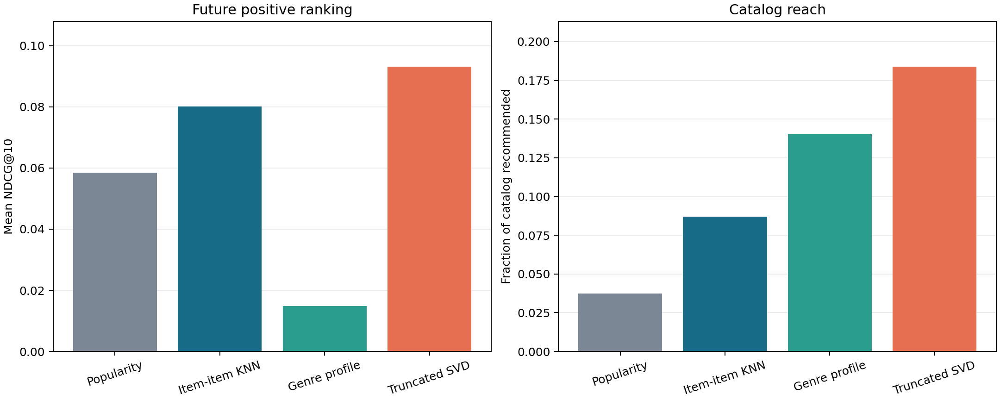
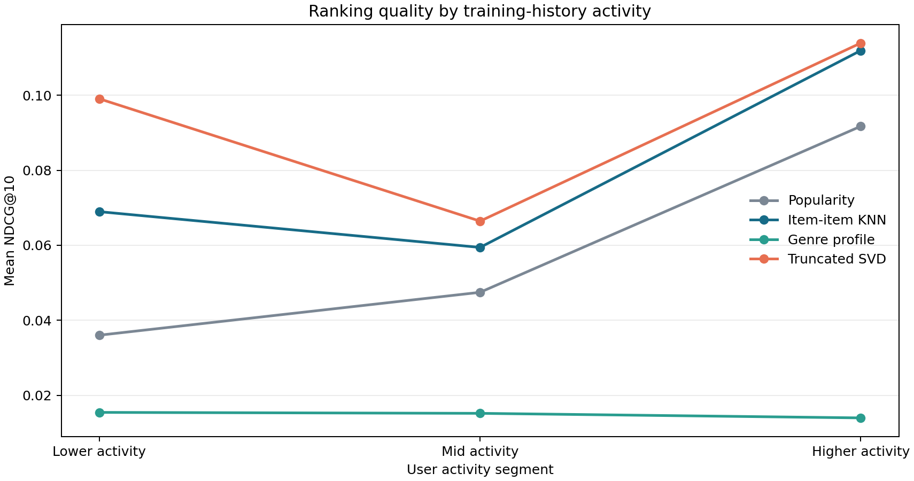

# MovieLens 1M temporal recommendation results

## Main result

The test window contains the latest per-user interactions after a chronological
train/validation split. The tables report full-catalog top-10 and top-20
recommendations for users with at least one future rating of four or five stars.
Each method uses the same eligible users and excludes items already rated before
the test window. Intervals are 95% seeded paired-user bootstrap intervals.

### Top-10 ranking quality

| Model | Precision@10 | Recall@10 | NDCG@10 | NDCG 95% CI | MAP@10 | Delta NDCG CI vs popularity |
| --- | --- | --- | --- | --- | --- | --- |
| Popularity | 0.0455 | 0.0493 | 0.0584 | [0.0553, 0.0615] | 0.0163 | [0.0000, 0.0000] |
| Item-item KNN | 0.0584 | 0.0717 | 0.0801 | [0.0762, 0.0843] | 0.0237 | [0.0189, 0.0246] |
| Genre profile | 0.0097 | 0.0170 | 0.0149 | [0.0132, 0.0164] | 0.0058 | [-0.0470, -0.0401] |
| Truncated SVD | 0.0644 | 0.0932 | 0.0931 | [0.0891, 0.0972] | 0.0290 | [0.0304, 0.0389] |

### Top-20 ranking quality

| Model | Precision@20 | Recall@20 | NDCG@20 | MAP@20 |
| --- | --- | --- | --- | --- |
| Popularity | 0.0388 | 0.0862 | 0.0681 | 0.0144 |
| Item-item KNN | 0.0487 | 0.1178 | 0.0923 | 0.0212 |
| Genre profile | 0.0086 | 0.0307 | 0.0195 | 0.0059 |
| Truncated SVD | 0.0554 | 0.1572 | 0.1125 | 0.0267 |

## Catalog discovery

| Model | Catalog coverage@10 | Catalog coverage@20 | Novelty@10 | Genre coverage@10 | Genre diversity@10 |
| --- | --- | --- | --- | --- | --- |
| Popularity | 0.0373 | 0.0574 | 8.0692 | 0.5250 | 0.6663 |
| Item-item KNN | 0.0870 | 0.1180 | 8.3818 | 0.5529 | 0.6796 |
| Genre profile | 0.1404 | 0.2197 | 12.2133 | 0.4220 | 0.2495 |
| Truncated SVD | 0.1839 | 0.2295 | 9.0716 | 0.5062 | 0.6535 |

The difference interval is for each model's user-level NDCG@10 minus popularity.
An interval entirely above zero is evidence of higher offline ranking quality
on this benchmark; it is not evidence of an online engagement lift.

## Activity groups

Users are divided into lower, middle, and higher activity groups by the number
of positive training interactions. The same group boundaries are used for all
models.

| Model | activity_segment | users | mean_train_positive_interactions | ndcg@10 | recall@10 |
| --- | --- | --- | --- | --- | --- |
| Popularity | Lower activity | 1,941 | 20.2700 | 0.0360 | 0.0523 |
| Popularity | Mid activity | 1,940 | 57.2608 | 0.0475 | 0.0509 |
| Popularity | Higher activity | 1,940 | 189.0103 | 0.0917 | 0.0447 |
| Item-item KNN | Lower activity | 1,941 | 20.2700 | 0.0690 | 0.0958 |
| Item-item KNN | Mid activity | 1,940 | 57.2608 | 0.0594 | 0.0642 |
| Item-item KNN | Higher activity | 1,940 | 189.0103 | 0.1119 | 0.0552 |
| Genre profile | Lower activity | 1,941 | 20.2700 | 0.0155 | 0.0223 |
| Genre profile | Mid activity | 1,940 | 57.2608 | 0.0152 | 0.0187 |
| Genre profile | Higher activity | 1,940 | 189.0103 | 0.0140 | 0.0099 |
| Truncated SVD | Lower activity | 1,941 | 20.2700 | 0.0990 | 0.1477 |
| Truncated SVD | Mid activity | 1,940 | 57.2608 | 0.0664 | 0.0730 |
| Truncated SVD | Higher activity | 1,940 | 189.0103 | 0.1139 | 0.0587 |

## Data and experiment audit

- Source: [MovieLens 1M from GroupLens](https://grouplens.org/datasets/movielens/1m/), a stable dataset released in 2003.
- Rows: 1,000,209 ratings from 6,040 users across 3,883 movie metadata records.
- Ratings of at least 4 stars are treated as positive feedback; positive share is 57.5%.
- Split rows: 794,691 train, 102,759 validation, 102,759 test; chronological ordering check: True.
- Validation-selected item-neighbor shrinkage: 5; SVD components: 32.
- Demographic `users.dat` was not loaded. Results and figures contain aggregate statistics only.

## Interpretation limits

MovieLens reflects users and titles from 2000–2003. Ratings depend on exposure
and are not a randomized measure of preference; unrated titles are unknown,
not confirmed negatives. Offline future-rating performance does not predict
current catalogs, new users, deployment engagement, or causal impact. Genre
diversity, novelty, and coverage are catalog proxies. The upstream dataset has
research-only terms; see [`NOTICE.md`](../NOTICE.md).

## Reproduction

Run `make fetch`, `make build`, and `make verify`. The raw source archive and
local recommendation bundle are ignored by Git. The bundle is needed to run
the local Streamlit demo or API and is not redistributed in this repository.
